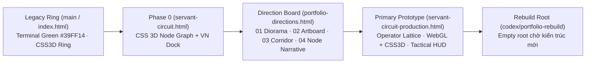

# ⧙ -▰▱- ꜟ ɪ ∴ Operator Lattice & Spatial Portfolio — Benchmark Research ∴ ɪ ꜟ -▱▰- ⧘

## 1. Hiện trạng Repository & Giải phẫu DNA từ các bản Prototype

Hiện tại trên workspace `D:/github/minato-makoto.github.io`:
- Nhánh đang checkout là `codex/portfolio-rebuild` (commit `88e0ddd` — `chore: start portfolio rebuild from empty root`), với working tree rỗng (chỉ giữ `.git`) để chuẩn bị xây mới từ đầu.
- Toàn bộ di sản prototype và handoff contract nằm trên nhánh `codex/operator-lattice-production-demo` (HEAD tại commit `b6ece6c`), bao gồm 4 lớp tiến hóa thiết kế rõ rệt:

### 1.1. Bốn trụ cột thiết kế của bản Prototype chính (`servant-circuit-production.html` — *Operator Lattice*)

| Trụ cột thiết kế | Đặc trưng trong Prototype của Minato-sama | Chi tiết kỹ thuật & thẩm mỹ cốt lõi |
| :--- | :--- | :--- |
| **1. Không gian 3D Hybrid (`WebGL + CSS3D`)** | Một camera phối cảnh duy nhất (`PerspectiveCamera` FOV 45°) chia sẻ giữa `THREE.WebGLRenderer` và `THREE.CSS3DRenderer`. | **Overview**: Lattice 2 cột dọc (`x = ±380`, `y = -row * 520`, cùng mặt phẳng `Z = 0`), gồm 11 mặt phẳng video 16:9 (`1280×720` DOM scale `0.5` → `640×360` world units). WebGL chỉ vẽ dây nối CubicBezier (`#b7dae8`) và port lục giác/kim cương; CSS3D giữ trọn iframe YouTube/Drive sắc nét ở cận cảnh. |
| **2. Chuyển động Camera theo Trạm (`Station Camera Choreography`)** | 3 trạng thái máy quay: `OVERVIEW` → `TRANSITIONING` → `STATION_LOCKED`. | Khi ở `OVERVIEW`, cuộn chuột trượt dọc trục Y của toàn mạng lưới kèm độ trôi parallax con trỏ cực kỳ tiết chế (`yaw <= 1.8°`, `pitch <= 1.2°`). Khi chọn node (`STATION_LOCKED`), camera dolly thẳng vào khung 16:9 của dự án, làm mờ các node ngoài tuyến (`opacity: 0.035`), đặt video nằm ngay phía trên bảng thông tin. |
| **3. Ngữ pháp Thị giác Tactical Telemetry × Editorial Contrast** | Sự kết hợp giữa **Editorial Serif** sang trọng và **Tactical FUI / Action-Game Rail** sắc lạnh. | **Bảng màu**: Nền đen sâu (`--bg-void: #0a0b0e`), kính tối (`rgba(6, 13, 22, 0.94)`), chữ ngà (`--text-ivory: #f0eee9`), xanh telemetry (`--accent-cyan: #43d8ff` & `--accent-cobalt: #1666b0`), nhãn đồng (`--accent-brass: #c8a95d`), và **một tín hiệu ngắt màu đỏ oxide duy nhất** (`--accent-oxide: #e23333`). **Typography**: `Instrument Serif` (tiêu đề thương hiệu) + `DM Sans` (tiêu đề dự án & nội dung) + `JetBrains Mono` (chỉ số node, telemetry, nhãn hệ thống). **Hình khối**: Các khung vát góc (`clip-path: polygon(...)`) kiểu vỏ giáp mô-đun (armored shell). |
| **4. Guided Route & Scripted AI/VN Presenter (`Witness π.3.14`)** | Thay vì menu lọc truyền thống, người xem đi theo **tuyến dẫn (`Route`)** cùng lời dẫn từ **Servant / Guide Object**. | Bộ chọn tuyến trên header (`All (11)`, `Producer`, `Post-Production`, `Process`) làm sáng các node thuộc tuyến. Ở đáy màn hình: cột trái là `Servant Telemetry Cue` (`Witness π.3.14 · Guide`), giữa là `Project Meta` mở theo chu trình `OPENING → STREAMING → READY` (gõ dòng `Intent` và `System / Proof`), phải là `Navigation Dock` (`← Prev`, `Overview`, `Next →`). |

> [!NOTE]
> Ngay trong mã nguồn của `servant-circuit-production.html`, ba hình mẫu kỹ thuật đã được ghi chú trực tiếp làm chuẩn đối chiếu (invariants):
> - **Lusion Invariant**: Giới hạn góc nghiêng parallax theo chuột (`<= 1.8deg yaw / 1.2deg pitch`, throttle ~30Hz) để không làm biến dạng hình học chữ và khung video.
> - **Haoqi Model**: Cây ngữ nghĩa trợ năng (`#a11y-live-region`, quản lý `aria-current`, `inert`, đồng bộ DOM và lớp 3D).
> - **Weisdevice Model**: Cơ chế `wakeLoop()` / tự ngắt `requestAnimationFrame` khi camera đã hội tụ (`posDist < 0.2`) hoặc khi ẩn tab (`visibilitychange`) để tiết kiệm GPU/pin.

---

## 2. Bản đồ các Website có Thiết kế & Kiến trúc Tương đồng

Để phục vụ việc tái thiết kế trên nhánh `codex/portfolio-rebuild`, dưới đây là các website thực tế (từ Awwwards SOTD/SOTY, FWA, Godly.website và các studio FUI/WebGL hàng đầu) khớp trực tiếp với từng mảng DNA trong prototype của Minato-sama:

### Nhóm A — Những hình mẫu trực tiếp đã neo trong Prototype (Direct Codebase Anchors)

#### 1. **HAOQI.DESIGN** — Haoqi Wen (`https://www.haoqi.design`)
- **Giải thưởng / Vị thế**: Awwwards Site of the Day (Design Engineer Portfolio).
- **Điểm tương đồng với Prototype**:
  - Là nguồn cảm hứng trực tiếp cho mô hình **Hybrid DOM + WebGL** và **Telemetry HUD** trong `servant-circuit-production.html`.
  - Sử dụng bố cục chữ và lưới bằng DOM/CSS thật (giữ độ sắc nét tuyệt đối và khả năng truy cập Screen Reader) kết hợp lớp cảnh Three.js/WebGL phía dưới.
  - Có thanh **Live Telemetry HUD** hiển thị trạng thái thời gian thực, hiệu ứng dot-matrix / character-scramble kiểu máy trạm retro-futurist, cùng bảng màu xanh cobalt sắc nét.
- **Bài học áp dụng cho Rebuild**: Cách đồng bộ hóa trạng thái cuộn (`ScrollBus` một nhịp `rAF` duy nhất giữa mượt hóa cuộn và Three.js) để không bị lệch 1 frame giữa node CSS3D và đường nối WebGL.

#### 2. **Weisdevice** — Xianyao Wei (`https://weisdevice.com` / `https://weisdevice.xyz`)
- **Giải thưởng / Vị thế**: Portfolio Creative Developer nổi bật trong cộng đồng Three.js / WebGL.
- **Điểm tương đồng với Prototype**:
  - Nguồn tham chiếu trực tiếp cho mục `// 12. RENDER LOOP & SLEEP MANAGEMENT (Model Weisdevice)`.
  - Thiết kế mang đậm tinh thần thiết bị cơ-điện tử tương tác (switches, knobs, bảng điều khiển lấy cảm hứng từ *Cyberpunk 2077*), nơi người dùng thao tác như vận hành một cỗ máy.
  - Kỹ thuật tối ưu hóa thực dụng: khóa tần số raycast/pointer ở 30 FPS và đóng băng vòng lặp render khi cảnh đứng yên hoặc khi người dùng đang đọc nội dung dự án.
- **Bài học áp dụng cho Rebuild**: Giữ nguyên kỷ luật "Zero-idle GPU" — chỉ chạy `rAF` khi đang chuyển trạm hoặc có tương tác chuột/cuộn.

#### 3. **Lusion (v3)** — Lusion Studio (`https://lusion.co`)
- **Giải thưởng / Vị thế**: Awwwards Site of the Year.
- **Điểm tương đồng với Prototype**:
  - Nguồn của quy tắc `// Pointer Parallax Drift (Lusion Invariant: <= 1.8deg yaw / 1.2deg pitch)`.
  - Cách Lusion biến trình duyệt thành một không gian triển lãm 3D liền mạch nhưng vẫn kiểm soát chặt chẽ góc máy (camera rig) khi đi vào từng case study video: máy quay không bao giờ xoay tự do gây chóng mặt mà trượt trên đường ray toán học (damped rail) có giới hạn góc nghiêng rất nhỏ.
- **Bài học áp dụng cho Rebuild**: Kết hợp chuyển động camera có trọng lượng (lerp damping) với đường dẫn thị giác nối giữa các khối dự án.

---

### Nhóm B — Ngữ pháp Tactical Telemetry, FUI & Modular Action-Game HUD

#### 4. **Arknights: Endfield Official Portal** — Hypergryph / Gryphline (`https://endfield.gryphline.com`)
- **Phong cách**: Industrial Sci-Fi FUI / Diegetic Tech-Wear / Tactical Telemetry.
- **Điểm tương đồng với Prototype**:
  - Khớp gần như hoàn hảo với dòng mô tả trong `servant-circuit-production.html`: `/* Presenter module: armored shell, blue telemetry, single Ark-red interrupt signal */` và trong `AGENTS.md`: *"blue tactical telemetry, segmented machinery and one restrained red prediction/interruption signal"*.
  - Sử dụng khung vát góc (`chamfered polygon`), các thanh tiến trình mảnh (`system-rail`), chấm vuông xoay 45° (`diamond status dot`), ký hiệu phân đoạn (`01 // MODULE`), và sự đối lập giữa nền tối công nghiệp với các dải tín hiệu xanh cyan / đỏ cảnh báo.
- **Bài học áp dụng cho Rebuild**:
  - Cách tổ chức **Asymmetrical Spatial Hierarchy** (bố cục bất đối xứng bám sát mép màn hình cho HUD để nhường toàn bộ vùng trung tâm cho không gian 3D/video).
  - Các vi tương tác (micro-interactions) khi chuyển tab/route: hiệu ứng quét thanh mảnh, nháy ký tự kiểu dữ liệu nạp vào bộ nhớ đệm trước khi khung thông tin mở ra hoàn toàn.

#### 5. **Igloo Inc.** — abeto × Bureaux (`https://igloo.inc`)
- **Giải thưởng / Vị thế**: Awwwards Site of the Year.
- **Điểm tương đồng với Prototype**:
  - Không gian 3D tối giản trên nền đen-xám lạnh được bao khung bởi lớp **HUD kỹ thuật dạng kính ngắm / máy trạm** (chỉ số tọa độ, vạch chia, typography monospace nhỏ gọn ở các góc).
  - Sự tiết chế tuyệt đối: lớp HUD mảnh, sắc như dao cạo, không lấn át vật thể trung tâm.
- **Bài học áp dụng cho Rebuild**: Tỷ lệ kích thước chữ monospace (`9px–11px`, `letter-spacing: 0.1em–0.15em`) và độ mờ viền (`rgba(255,255,255,0.08)` đến `0.22`) giúp giao diện FUI trông giống thiết bị quang học cao cấp thay vì giao diện game màu mè.

#### 6. **Territory Studio** (`https://territorystudio.com`) & **Perception** (`https://experienceperception.com`)
- **Vị thế**: Hai studio thiết kế FUI (Fictional User Interface) và hậu kỳ hình ảnh hàng đầu thế giới (*Blade Runner 2049*, *Dune*, *The Martian*, *Marvel Studios*).
- **Điểm tương đồng với Prototype**:
  - Cả hai đều giải bài toán của một **Video Producer / Post-Production / VFX Portfolio**: làm sao để đặt các video showreel nhiều màu sắc bên trong một khung giao diện mang đậm chất hệ thống kỹ thuật mà không làm lệch màu (color cast) của bản dựng.
  - Giải pháp của họ giống hệt định hướng trong `servant-circuit-production.html`: vùng quanh video dùng tông `#0a0b0e` trung tính tuyệt đối, còn các chỉ báo kỹ thuật (telemetry) được đẩy ra viền ngoài hoặc module bên dưới.

---

### Nhóm C — Không gian 3D Video Planes, Depth Corridor & Editorial Contrasts

#### 7. **Unseen Studio** (`https://unseen.co`)
- **Giải thưởng / Vị thế**: Awwwards Studio of the Year / SOTD.
- **Điểm tương đồng với Prototype**:
  - Sự kết hợp giữa **Editorial Serif mềm mại, sang trọng** (tương tự `Instrument Serif` của Minato-sama) với **không gian 3D tương tác mượt mà** và các dự án thiên về motion/video.
  - Khi người xem duyệt qua danh sách dự án ở chế độ toàn cảnh (Overview) rồi bấm vào một dự án, camera trượt vào mặt phẳng video đó trong khi các mặt phẳng xung quanh lùi sâu hoặc mờ đi.
- **Bài học áp dụng cho Rebuild**: Cách cân bằng giữa chất "nghệ sĩ/đạo diễn hình ảnh" (qua font Serif + khoảng thở) và chất "kỹ sư hệ thống" (qua chuyển động 3D chính xác), giúp nhà tuyển dụng/khách hàng thương mại cảm nhận được gu thẩm mỹ cao cấp ngay lập tức.

#### 8. **Active Theory (v5 / v6)** (`https://activetheory.net`)
- **Giải thưởng / Vị thế**: Huyền thoại WebGL / Awwwards SOTD & FWA.
- **Điểm tương đồng với Prototype**:
  - Cấu trúc **Spatial Case-Study Corridor / Lattice**: các dự án là những mặt phẳng cổng (portals) nằm trong không gian 3D tối có sương mù chiều sâu (`FogExp2`), được nối với nhau bằng các đường dẫn năng lượng/dữ liệu.
  - Khi khóa vào một trạm (Station), video phát ngay trong không gian cùng bảng thông tin kỹ thuật bên dưới và nút điều hướng tiến/lùi giữa các trạm.
- **Bài học áp dụng cho Rebuild**: Cách xử lý đường nối (noodles/rails) có tín hiệu xung ánh sáng chạy dọc từ node đang chọn sang node kế tiếp trong tuyến (`Route`).

#### 9. **Kenta Toshikura** (`https://kentatoshikura.com`) & **Aristide Benoist** (`https://aristidebenoist.com`)
- **Giải thưởng / Vị thế**: Awwwards Independent of the Year / SOTD.
- **Điểm tương đồng với Prototype**:
  - Bậc thầy về **Spatial Plane Choreography** (điều phối các mặt phẳng dự án 2D trong không gian 3D): gần với hướng `01 Spatial Diorama` và `03 Depth Corridor` trong `portfolio-directions.html` cũng như phép chiếu phẳng (`Z = 0`) trong `servant-circuit-production.html`.
  - Mọi mặt phẳng ảnh/video giữ tỷ lệ khung hình chuẩn xác tuyệt đối; chiều sâu đến từ chuyển động camera, độ mờ phân lớp và nhịp điệu chuyển cảnh (`cubic-bezier(.22, .8, .2, 1)`).

---

### Nhóm D — Node-Graph, Infinite Artboard & Guided Narrative (Dẫn tuyến thông minh)

#### 10. **Pryzm** (`https://pryzm.io`) & **React Flow / Spatial Node Showcases** (`https://reactflow.dev/showcase`)
- **Phong cách**: 3D/2.5D Node-Graph Workspace & Procedural Pipeline UI.
- **Điểm tương đồng với Prototype**:
  - Ngôn ngữ **Node + Port (`in`/`out`) + CubicBezier Noodle** của `servant-circuit-production.html` và `04 Node Narrative` lấy cảm hứng trực tiếp từ các công cụ hậu kỳ/3D theo node như **DaVinci Resolve Fusion**, **Blender Geometry/Shader Nodes**, và **Nuke**.
  - Với vai trò của Minato-sama là **Producer / Post-Production Supervisor / Colorist / VFX** (và trong repo cũng ghi dấu `Previs / Blender 5.2 · Operator Lattice`), việc biến chính portfolio thành một **Node Graph hậu kỳ 3D** là một ẩn dụ nghề nghiệp (occupational metaphor) cực kỳ đắt giá: mỗi dự án là một Operator Node xử lý từ `Intent` (Input) sang `Proof` (Output).

#### 11. **Henry Heffernan** (`https://henryheffernan.com`) & **Jesse Zhou** (`https://jesse-zhou.com`)
- **Phong cách**: Hybrid `THREE.WebGLRenderer` + `THREE.CSS3DRenderer` Interactive Station.
- **Điểm tương đồng với Prototype**:
  - Hai case study tiêu biểu nhất về mặt kỹ thuật sử dụng `CSS3DRenderer` để nhúng DOM/iframe tương tác thật vào cảnh Three.js mà vẫn giữ được độ nét gốc của trình phát và văn bản.
  - Minh chứng cho quyết định kỹ thuật trong `AGENTS.md`: giữ nguyên kích thước logic `1280×720` và hạ `scale(0.5)` trong `CSS3DObject` để khi camera dolly sát lại gần ở chế độ `STATION_LOCKED`, iframe không bị vỡ hạt (pixelated).

---

## 3. Ma trận Đối chiếu & Gợi ý Tinh chỉnh cho Nhánh `codex/portfolio-rebuild`

| Thành phần trong Prototype | Điểm mạnh hiện có của Minato-sama | Tham chiếu học hỏi thêm từ các Site cùng gu |
| :--- | :--- | :--- |
| **Node Lattice & Signal Path** | Bố cục 2 cột đồng phẳng `Z=0` giúp so sánh kích thước các dự án công bằng, không bị méo phối cảnh; đường nối Bezier chạy dưới media rất gọn. | Học từ **Active Theory** & **DaVinci Resolve Fusion UI**: làm nổi bật rõ hơn đường dây (noodle) của **tuyến đang chọn (`Active Route`)** so với dây chung, giúp người xem thấy ngay luồng chảy từ trạm 1 → trạm 2 → trạm 3. |
| **Tactical HUD & Presenter (`Witness π.3.14`)** | Sự kết hợp `Instrument Serif` + `DM Sans` + `JetBrains Mono` cùng vỏ giáp vát góc và 1 vạch đỏ `#e23333` tạo bản sắc rất riêng, thoát khỏi kiểu "hacker xanh lá" cũ của bản Angular đầu tiên. | Học từ **Arknights: Endfield** & **Igloo Inc.**: giữ viền HUD mảnh và sắc; khi chuyển giữa các trạm, thêm phản hồi thị giác cực ngắn trên thanh `system-rail` và trạng thái của `Witness π.3.14` để tăng cảm giác "hệ thống đang dẫn đường sống động". |
| **Media & Iframe Lifecycle** | Cơ chế nạp tuần tự 1 iframe mỗi lượt (`warmPlayerQueue`) và giữ nguyên DOM identity xuyên suốt `OVERVIEW ↔ STATION_LOCKED` là giải pháp kỹ thuật rất vững cho Google Drive / YouTube. | Học từ **Territory Studio** & **Unseen Studio**: thêm lớp khung viền quang học / trạng thái chờ (loading telemetry shimmer) tinh tế cho các trạm chưa nạp xong trong hàng đợi để ngay cả khi Drive đang tải, node vẫn trông như một màn hình giám sát đang khởi động. |
| **Định vị Nghề nghiệp (Producer / Post)** | Tách thành 3 tuyến mục đích (`Producer`, `Post-Production`, `Process`) kèm cấu trúc `Intent` → `System / Proof`. | Kết hợp tinh thần của `02 Infinite Artboard` / `04 Node Narrative`: cho phép khách hàng hiểu ngay *vì sao* thứ tự các node được nối như vậy khi họ chọn một tuyến (ví dụ: tuyến `Producer` đi từ dự án làm chủ toàn diện sang điều phối thương mại). |

---

## 4. Quá Trình Phát Triển Bản Prototype (`z-journey-prototype.html`)

Dưới đây là toàn bộ tiến trình nghiên cứu, dựng thử và tinh chỉnh lặp theo từng vòng phản hồi thực tế để hình thành bản prototype ở trạng thái hiện hành tại `z-journey-prototype.html` (đồng thời được đồng bộ sang `index.html`).

```mermaid
flowchart TD
  P0["Phase 0: Research Repo cũ (b6ece6c) & 11 Benchmark Sites<br/>WebGL + CSS3D Shared Camera · Tactical HUD"] --> P1["Phase 1: Demo đầu tiên từ PDF (index.html)<br/>Lưới 2 cột phẳng Z=0 · Dossier Modal"]
  P1 -->|"Đánh giá còn AI slop -> Rebuild HTML mới"| P2["Phase 2: Z-Journey Prototype v1 (z-journey-prototype.html)<br/>Human FUI 4 lớp Z · CatmullRomCurve3 Spline · Tether Chat"]
  P2 -->|"6 tinh chỉnh UX & dữ liệu"| P3["Phase 3: Constellation Overview + VN Point-and-Click<br/>500x300 Node · Bỏ ô nhập chat & link PDF · Nhúng data vào Node 00/04"]
  P3 -->|"Động học, TextFX & chống chắn click"| P4["Phase 4: CAM_STATION_DIST 560m / bước 900m · Hermite Ease-In-Out<br/>Window.TextFX 4 preset · Ẩn Node đã qua · Loop animation"]
  P4 -->|"Tiết chế nhịp chuyển động & Hồ sơ Node 00"| P5["Phase 5: Bỏ toàn bộ nhấp nháy Opacity · Giảm biên độ lơ lửng 3D<br/>Làm chậm TextFX · Cascade animation cho Data Sheet Node 00"]
  P5 -->|"Research Dreamina / Flora Canvas UI"| P6["Phase 6: Overview VN Console hội tụ 13 dây vào HUB_IN<br/>Journey 3D Sub-HUD + Code Convergence Glitch"]
  P6 -->|"Tái cấu trúc Production & VN HUD"| P7["Phase 7 (Production): Modular CSS/JS Architecture · 2-Phase Sub-HUD OUT->IN<br/>Full-Width VN Box + External 3-Btn HUD Rail"]
  P7 -->|"Round 2: FUI Laser Jaws, 3D Dihedral & Minimalist VN"| P8["Phase 8 (Round 2): FUI Laser Shutter 500ms OUT / 780ms IN · Node 640x384<br/>Opposite 3D Tilt (origin 0% 50%) · Right Save/Load Rail · Scroll 2 chiều"]
  P8 -->|"Round 3: Persistent Sub-HUD, Vertical Tower & Dreamina Stream"| P9["Phase 9 (Round 3): 1 Sub-HUD xuyên suốt cố định · 13 Node dọc ở Overview<br/>Oval Capsule + Comet Trail · Z-Invariant Parallax · 4-Corner/4-Edge Hover Glow"]
```

### 4.1. Phase 0–1 — Kiểm toán Prototype cũ & Demo đầu tiên từ Presentation PDF
- **Đầu vào**: Mã nguồn nhánh `codex/operator-lattice-production-demo` (`b6ece6c`), nhánh rỗng `codex/portfolio-rebuild` (`88e0ddd`), cùng bộ slide 12 trang `Portfolio_LuongBaoHuy_EN.pdf`.
- **Thực hiện**: Tổng hợp ma trận 11 website tham chiếu (Mục 1–3) và dựng bản demo HTML đầu tiên tại `index.html` theo kiến trúc *Operator Lattice* (2 cột đồng phẳng `Z = 0`, 11 video `1280×720` scale `0.5`, thêm bảng `Dossier // Resume` lấy dữ liệu từ PDF).
- **Lý do chuyển hướng**: Giao diện sau Phase 1 vẫn mang cảm giác "AI slop" (thẻ kính tối lặp công thức, viền dày, lưới 2D tĩnh). Từ yêu cầu *rebuild hoàn toàn theo ngôn ngữ node không gian 3D có trục Z*, toàn bộ phần thiết kế được tách sang tệp mới `z-journey-prototype.html`.

### 4.2. Phase 2 — Rebuild Human FUI × Z-Axis Spline Corridor (`v1`)
- **Tham chiếu thiết kế**: *Ash Thorp*, *Jayse Hansen*, *Davison Carvalho* (mật độ FUI điện ảnh đa lớp), kết hợp hành trình camera theo trục Z (*Immersive Garden*, *makemepulse*, *Resn*).
- **Kiến trúc dựng nền**:
  - Xây đường ray 3D `CatmullRomCurve3` (`signalSpline`, `cameraSpline`, `lookSpline`) đi qua 13 Node dọc chiều sâu âm trục Z, có cổng đo khoảng cách (Depth Gates), bụi hạt 3D (`dustParticlesMesh`) và xung tín hiệu chạy dọc spline (`pulsePointsMesh`).
  - Thiết kế mỗi Node gồm **4 tầng chiều sâu `preserve-3d`**: nền lưới/số thứ tự mờ (`Layer -1`), mặt phẳng poster SVG & khe video/data sheet (`Layer 0`), 4 ngàm góc chữ L (`Layer +1`), và vòng chuẩn trực quang học xoay tròn + nội dung chữ (`Layer +2`).
  - Dùng phép chiếu 3D→2D (`Vector3.project(camera)`) để vẽ đường dẫn SVG (`#tether-svg`) nối trực tiếp từ Node 3D vào khung chat thuyết minh.
- **Lý do phát sinh `index.html` song song**: Từ phase này trở đi, sau mỗi đợt cập nhật `z-journey-prototype.html`, nội dung được copy đè sang `index.html` để giữ đồng bộ trang gốc mặc định cho GitHub Pages.

### 4.3. Phase 3 — Trang Toàn Cảnh, Thu gọn Node & Chuẩn hóa Visual Novel Script
Từ phản hồi sau Phase 2, prototype được chỉnh lại toàn diện:
1. **Bổ sung chế độ `OVERVIEW` (Constellation Overview)**: Khi mới mở trang (hoặc nhấn `❖ Toàn cảnh (13)` / `Esc`), cả 13 Node dàn thành chòm sao không gian 3D để quan sát tổng thể; chỉ khi click vào một Node mới bay vào chế độ `JOURNEY`.
2. **Thu gọn Node HUD**: Giảm kích thước gốc `.hud-node` từ `760×460px` xuống `500×300px` để giao diện thanh thoát, không choáng hết màn hình.
3. **Visual Novel Point-and-Click + Gộp điều hướng**: Loại bỏ ô nhập liệu chat tự do (`#chat-form`) do không dùng model API ngoài, giữ cơ chế chạy chữ theo script cùng 4 nút lựa chọn nhánh (`.prompt-chip`); đồng thời gộp 3 nút điều hướng (`← Prev Node`, `❖ Toàn cảnh (13)`, `Next Node →`) vào trong khung chat, xóa thanh điều khiển đáy trang bị trùng.
4. **Làm mềm đường cong chuyển động**: Giảm biên độ nghiêng chuột và chuyển easing sang đường cong mượt (`cubic-bezier(0.22, 1, 0.36, 1)`).
5. **Loại bỏ toàn bộ link/nút PDF Deck**: Chỉ dùng `Portfolio_LuongBaoHuy_EN.pdf` làm nguồn nội dung, nhúng thẳng hồ sơ năng lực, timeline `2015 – Present` và danh mục dự án (*VIB "It's Her"*, *ALPHA by AIA*, *Metro Group*, *YBA*, *Nhạc Viện TP.HCM*, *VIFA EXPO*, *NORITER*, *BCVN*) vào cấu trúc Data Sheet (`mediaType: 'sheet'`) của **Node 00 (`genesis-node`)** và **Node 04 (`vib-itsher-node`)**.

### 4.4. Phase 4 — Động học Camera Cận Node, Hermite Flight, `TextFX` & Loop Animation
- **Khắc phục lỗi Node cũ chắn thao tác click**: Đặt khoảng cách quan sát trạm `CAM_STATION_DIST = 560` với bước nhảy giữa các trạm dọc trục Z là `900m` (`Z = 0m` đến `Z = -10,800m`), giúp camera luôn đứng vượt qua Node trước đó `340m`. Áp dụng `.is-passed` và `.is-behind-cam` (`visibility: hidden; pointer-events: none`) cho các trạm phía sau camera.
- **Đường bay C1 Cubic Hermite (`launchProgressFlight`)**: Tăng tốc độ cuộn (`ev.deltaY * 0.00092`) theo đường cong tăng tốc dần – giảm tốc dần (`480ms–820ms`), kèm lực hút tự động vào Node gần nhất sau `150ms` dừng cuộn.
- **Thị sai 3D cận trạm**: Trong `JOURNEY`, di chuyển con trỏ làm dịch chuyển nhẹ camera, góc nhìn `lookAt`, góc nghiêng hành lang `corridorGroup` (`±0.028 rad`), lớp bụi hạt và góc xoay của Node đang mở.
- **Khôi phục & module hóa hiệu ứng chữ (`TextFX`)**: Bổ sung bộ `window.TextFX` với 4 preset kích hoạt qua `data-text-fx`: `cipher` (giải mã ký tự), `telemetry` (đếm số/tọa độ), `stagger` (trượt tách token), và `typewriter` (gõ chữ).
- **Khung chat mượt hơn**: Gỡ bỏ chấm nháy đỏ ở đầu header chat, thay bằng ký hiệu tĩnh `⧙`, và giảm tốc độ stream chữ xuống nhịp Visual Novel chậm rãi (`2 ký tự / 36ms`, ngắt nghỉ theo dấu câu).

### 4.5. Phase 5 — Tiết chế Nhịp Chuyển Động & Animation Hồ Sơ Node 00
- **Loại bỏ hoàn toàn hiệu ứng nhấp nháy opacity**: Xóa toàn bộ nháy đèn/opacity trên cột sóng âm, góc ngắm `.hud-corner`, thanh quét và vòng xung dây nối; chỉ giữ lại vòng lặp **di chuyển vị trí và xoay đều** (`hud-spin-cw`/`ccw`, `grid-drift-loop`, `node-horizon-loop`, hạt `#tether-packet` trượt dọc dây nối).
- **Hãm biên độ trôi 3D của Node HUD**: Hạ biên độ lơ lửng trong `tick()` xuống còn `bobY = 2.2px` (tần số `0.85`), `bobX = 1.1px` (tần số `0.65`) và độ nghiêng `bobRz = 0.0022 rad` để tổng thể đằm mắt hơn.
- **Giảm tốc `TextFX`**: Kéo dài thời gian giải mã `cipher` lên `920ms` (`95ms/step`), `telemetry` lên `880ms` (`68ms/step`), `stagger` (`55ms/token`) và `typewriter` (`780ms`).
- **Animation trang Hồ sơ (`.node-data-sheet.is-sheet-active`)**: Khi mở Node 00 / Node 04, kích hoạt tia sáng quét ngang trên đỉnh, header trượt xuống cùng `TextFX`, 6 thẻ timeline sự nghiệp hiện nối tiếp theo thứ tự (`--cell-i: 0..5`), và 5 thanh năng lực chạy tiến trình từ `0%` tới đúng giá trị thực.

### 4.6. Phase 6 — Kiến trúc Canvas Node UI (*Dreamina / Flora Style*) & Trạng thái Hiện hành
- **Research tham chiếu**: Khảo sát mô hình giao diện Canvas Node vô cực của **Dreamina Canvas**, **Flora (`FloraFauna`)** và **ComfyUI** — nơi đối tượng chính (*Main Asset Node*) nối dây cong *Cubic Bezier* qua cổng port socket (`◉`) sang bảng thông số gắn thẻ tham chiếu (`Prompt / Inspector Sub-HUD` kèm chip `@NODE_XX`).
- **Cấu trúc hai trạng thái đang chạy ở snapshot hiện tại (`3,862` dòng, `144,513` bytes)**:
  1. **`OVERVIEW` mode**: `#chat-dock` neo giữa đáy màn hình (`width: min(840px, calc(100vw - 44px)); height: 214px`) dạng Visual Novel console; 13 Node trên màn hình đồng loạt kéo dây cong từ cổng đáy (`.port-bottom`) hội tụ về **1 cổng chung duy nhất** `#chat-port-top` (`HUB_IN // 13 NODES`).
  2. **`JOURNEY` mode**: Main Node HUD đứng lệch trái (góc xoay `ry = +0.15 rad`, offset camera `x + 160` / `lookAt x + 144`) kéo dây Bezier từ cổng `.port-right` sang `#chat-port-left` (`IN // ASSET_LINK`) của **Sub-HUD 3D cố định tỉ lệ** bên phải (`width: min(468px, 42vw); height: 448px`, `perspective: 1200px`, `.subhud-rig` xoay `rotateY(-11.5deg)` đối xứng với Main Node).
  3. **Hiệu ứng xuất hiện Sub-HUD (`triggerSubHudMaterialize`)**: Khi mở/chuyển Node trong `JOURNEY`, kích hoạt `subhud-glitch-in` kết hợp 12 mảnh `.converge-token` hội tụ code vào tâm khung.
- **Ghi chú về lượt thử nghiệm & hoàn tác**: Đã có một lượt thử nghiệm tái cấu trúc (bổ sung animation `OUT`, đưa cụm 3 nút ra ngoài khung, xếp dọc choice ở Overview và đổi góc 3D Sub-HUD để sửa hit-test), sau đó được rollback nguyên vẹn về đúng snapshot cuối của Phase 6 (`SHA-256: 68c3f45dc7983a0fa60652346624492a30c6377f792446cb0e9598a443e6ba6f`) theo yêu cầu của Minato-sama.

### 4.7. Phase 7 — Tái cấu trúc Production (Xóa Prototype Monolith) & Chuẩn hóa Visual Novel Sub-HUD
- **Xóa bỏ hoàn toàn tệp Prototype cũ (`z-journey-prototype.html`) & Tách Module Production**:
  - Loại bỏ cấu trúc 1 file monolith `3,862` dòng và tách thành kiến trúc production tĩnh sạch sẽ gồm `index.html`, 3 tệp CSS (`assets/css/tokens.css`, `assets/css/stage-nodes.css`, `assets/css/chrome-hud.css`) và 4 tệp JS (`assets/js/nodes-data.js`, `assets/js/text-fx.js`, `assets/js/subhud-controller.js`, `assets/js/scene-engine.js`) kèm định tuyến deep-link (`#all/overview`, `#all/genesis-node`, v.v.).
- **Chuẩn hóa Bố cục Visual Novel (Không chia đôi khung ở trang chính + Tăng chiều cao + Đưa 3 nút điều hướng ra ngoài khung)**:
  - Tham chiếu bố cục hội thoại của các Visual Novel / Sci-Fi RPG hiện đại (*13 Sentinels: Aegis Rim*, *Arknights: Endfield*, *Steins;Gate*, *Fate/stay night Remastered*):
  - Khung hội thoại ở cả `OVERVIEW` lẫn `JOURNEY` đều xếp dọc (`flex-direction: column`): phần hội thoại (`.chat-stream`) chiếm trọn chiều ngang phía trên, và 4 nút lựa chọn nhánh (`.chat-prompts` đánh số `[01]`..`[04]`) nằm ở khay dưới cùng bên trong khung chính (`.subhud-chassis`).
  - Tăng chiều cao khung chính `.subhud-chassis` ở `OVERVIEW` từ `214px` lên **`304px`** (`width: min(860px, calc(100vw - 44px))`) và ở `JOURNEY` từ `448px` lên **`488px`** (`width: min(520px, 43vw)`).
  - Tách cụm 3 nút điều hướng (`← Prev Node`, `❖ Toàn cảnh (13)`, `Next Node →`) ra khỏi khung chính thành thanh điều khiển `.subhud-external-rail` nằm **bên ngoài ngay phía dưới khung chính** nhưng vẫn thuộc `.subhud-rig` (nối cơ khí với đáy khung bằng 2 ngàm `.subhud-external-rail::before/::after`).
- **Chu trình Hiệu ứng `OUT → IN` Hai Chiều cho Sub-HUD (`SubHudController.runSubHudTransition`)**:
  - Khắc phục triệt để việc thiếu hiệu ứng `OUT` và lỗi xung đột compositing khi đổi Node / đổi chế độ:
  - **Pha `OUT` (`220ms` — `.is-transitioning-out` + `body.is-subhud-out`)**: Khung `.subhud-chassis` và thanh `.subhud-external-rail` thu sập theo khe quang học (`subhud-chassis-out`, `subhud-rail-out`), phóng 8 mảnh `.converge-token.is-diverging` tán xạ ra ngoài và thu mờ dây nối tether.
  - **Pha `IN` (`480ms` — `.is-transitioning-in`)**: Sau khi cập nhật nội dung ở điểm giữa chu trình, khung mới bung mở từ đường chân trời (`subhud-chassis-in`), tia quét `.subhud-glitch-bar` trượt dọc, 4 ngàm góc khóa vào vị trí và 12 mảnh `.converge-token` hội tụ vào tâm Sub-HUD.
- **Tăng Kích Thước Cặp HUD, Kéo Gần Khoảng Cách & Triệt Tiêu Vùng Chết Click Bên Trái Sub-HUD**:
  - Tăng kích thước gốc `.hud-node` từ `500×300px` lên **`580×348px`** (hiển thị trên màn hình `1440×900` ở chế độ `JOURNEY` đạt `568×343px`, nằm từ `x = 186px` đến `754px`, tách biệt hoàn toàn khỏi thanh Z-scrubber bên trái).
  - Đặt Sub-HUD ở `left: min(calc(50% + 128px), calc(100vw - 544px))` (`x = 848px` đến `1368px` trên màn `1440×900`), rút ngắn khoảng cách giữa Main Node HUD và Sub-HUD xuống còn **`95px`**.
  - Gỡ bỏ `transform-style: preserve-3d` + `rotateY(-11.5deg)` trên `.chat-dock` (nguyên nhân khiến nửa trái Sub-HUD lùi về `Z < 0` sau mặt phẳng hit-test gốc `Z = 0`), chuyển `.chat-dock` sang `pointer-events: none` phẳng và cấp `pointer-events: auto` trực tiếp cho `.subhud-chassis` và `.subhud-external-rail`. Kiểm thử CDP xác nhận 100% điểm click ở sát mép trái Sub-HUD (`[01]`, `[03]`, `← Prev Node`, `.chat-header-left`) hoạt động chính xác tuyệt đối.

### 4.8. Phase 8 (Round 2) — FUI Laser Shutter Jaws, 3D Opposite Dihedral Tilt, Tối giản Visual Novel & Điều hướng Cuộn 2 Chiều
- **Nâng cấp Hiệu ứng `IN / OUT` của Sub-HUD theo mẫu Human-Crafted FUI Laser Shutter (`500ms` OUT → `780ms` IN)**:
  - Thay vì dùng `scaleY(0.016)` trên khung kính tối (khiến đường viền `1px` bị co xuống sub-pixel không nhìn thấy), bổ sung **cặp thanh Laser Shutter Jaws tách ngoài `overflow: hidden`** (`.subhud-main-wrap::before` và `::after`, dày `3.5px` với bloom neon `box-shadow: 0 0 28px var(--phosphor), 0 0 14px var(--signal)`) kết hợp màn chập `clip-path: inset(...)` và lớp chớp sáng CRT (`.subhud-chassis::after`).
  - **Pha `OUT` (`500ms`)**: Hai thanh laser trên/dưới kẹp sập vào đường tâm ngang (`50%`) kèm chớp sáng CRT, sau đó thu ngang về tâm (`scaleX(0.01)`) cùng 8 mảnh code `.converge-token.is-diverging` bắn tung ra ngoài.
  - **Pha `IN` (`780ms`)**: Tia laser ngang bắn vọt ra toàn chiều rộng tại tâm (`scaleX(0.02) -> scaleX(1.04)`), sau đó tách dọc lên đỉnh (`0%`) và đáy (`100%`) mở toang khung Sub-HUD cùng 12 mảnh code hội tụ.
- **Tăng kích thước Main Node HUD, Dịch Sub-HUD sang phải & Tạo độ nghiêng 3D Ngược chiều mà không mất Click**:
  - Nâng kích thước gốc `.hud-node` lên **`640×384px`** (`targetScale = 0.54`, `CAM_STATION_DIST = 535`, góc nghiêng `+0.12 rad` hướng vào trong), hiển thị trên màn `1440×900` đạt `~614×372px` (`x = 202px..777px`, tách rời hoàn toàn khỏi thanh Z-scrubber bên trái).
  - Dịch Sub-HUD sang phải (`right: clamp(44px, 3.8vw, 68px); width: min(512px, 39vw);`, cách Main Node HUD `~96px`) và áp dụng độ nghiêng 3D ngược chiều với Main Node HUD: `transform-origin: 0% 50%; transform: perspective(1150px) rotateY(calc(-9.5deg + var(--sub-ry))) rotateX(calc(1.3deg + var(--sub-rx)))`. Nhờ đặt tâm xoay tại mép trái (`0% 50%`), toàn bộ diện tích Sub-HUD luôn có `Z >= 0`, giữ nguyên **100% khả năng click ở mép trái** trong khi vẫn tạo góc nghiêng 3D đối xứng hoàn hảo với Main Node HUD.
- **Bỏ 4 nút lọc ở giữa Header & Trang trí lại bằng FUI Optical Compass Deck**:
  - Loại bỏ hoàn toàn cụm 4 nút `.route-filter-bar` ở giữa thanh `.chrome-top`, thay bằng thước la bàn quang học `.header-compass-deck` (`AZIMUTH // Z-AXIS`, dải vạch chia dịch chuyển theo góc nhìn `--compass-shift`, tâm khóa `◆ WITNESS π.3.14` và `OPTICAL LOCK`) cùng biểu tượng nhận diện `.brand-emblem` (`⧙`).
- **Tối giản hóa Sub-HUD ở Trang chính (`OVERVIEW`) chuẩn Visual Novel & Chuyển 3 nút sang bên phải kiểu Save/Load**:
  - Ở `OVERVIEW`, ẩn hoàn toàn thanh `.chat-node-banner`, nhãn kỹ thuật phụ và khung viền tin nhắn; chỉ giữ lại thanh tên nhân vật `WITNESS π.3.14`, **1 lời thoại sạch sẽ duy nhất** bằng font serif `Instrument Serif` cỡ lớn và 4 lựa chọn nhánh ở đáy.
  - Chuyển cụm 3 nút điều hướng (`.subhud-external-rail`) từ đáy khung sang **cột dọc bên phải ngoài khung chính** (`SLOT 01 // ▲ PREV`, `SLOT 02 // ❖ MAP`, `SLOT 03 // ▼ NEXT`), mô phỏng đúng cụm nút chức năng `SAVE / LOAD / LOG` nằm bên hông phải hộp thoại trong các game Visual Novel cổ điển và hiện đại.
- **Cuộn chuột 2 chiều (`OVERVIEW` ↔ `Node 00`) & Giảm tốc độ bay mượt mà**:
  - Khi ở trang chính (`OVERVIEW`), cuộn chuột xuống sẽ bay vào `Node 00`; khi đang ở `Node 00` (`state.activeNodeIndex === 0 && state.currentProgress <= 0.035`), cuộn chuột lên (hoặc nhấn `SLOT 01 // ▲ PREV`) sẽ quay trở lại trang chính (`OVERVIEW`).
  - Giảm hệ số xung lực cuộn chuột từ `0.00092` xuống **`0.00045`** (giới hạn `±0.068` mỗi nhịp), kéo dài thời gian bay Hermite (`860ms` khi cuộn, `780ms` khi bắt trạm, `900–1360ms` khi chuyển trạm) và hạ hệ số nội suy camera/node trong `tick()` xuống **`0.068`** để chuyển động đằm và mượt hơn.

### 4.9. Phase 9 (Round 3) — Sub-HUD Xuyên Suốt Cố Định, Bố Cục Dọc Trang Chính, Dreamina Oval Stream & Sửa Lỗi Động Học 3D
1. **1 Sub-HUD Xuyên Suốt Cố Định & Bố Cục 13 Node Theo Chiều Dọc ở `OVERVIEW` (Mục 1, 2, 12)**:
   - Xếp lại 13 Node ở `OVERVIEW` thành tháp 2 cột dọc so le bên trái-giữa sân khấu (`x = -340` cho node chẵn, `x = +80` cho node lẻ, `y` từ `+630` xuống `-630`), tất cả nối dây từ cổng `.port-right` sang cổng trái `#chat-port-left` của Sub-HUD.
   - Bỏ hoàn toàn hiệu ứng `in/out` của Sub-HUD và bỏ nút thu gọn (`#chat-min-btn`); giữ **1 Sub-HUD duy nhất luôn hiển thị cố định ở trạng thái mở rộng (`height: 504px`, `width: min(528px, 40vw)`)** tại cùng một vị trí bên phải xuyên suốt cả `OVERVIEW` lẫn `JOURNEY` (chỉ làm mới nội dung chữ và nút lựa chọn).
2. **Thiết Kế Khung Chat Tối Giản Chuẩn Platform Hiện Đại & Tăng Cỡ Chữ (Mục 3, 4, 5, 6)**:
   - Loại bỏ toàn bộ thông tin lặp lại trên Sub-HUD (`.chat-node-banner`, `.subhud-ghost-tag`, `.chat-node-type-pill`, `#chat-sub-status`, header người gửi/thời gian trên từng bong bóng chat).
   - Tăng cỡ chữ tin nhắn `.chat-msg` lên **`15px`** (`line-height: 1.64`), nút lựa chọn `.prompt-chip` lên **`13px`** xếp 1 cột full-width, và bỏ chữ `"SLOT"` trên 3 nút bên phải (`▲ PREV`, `❖ MAP`, `▼ NEXT` với icon `18px`, nhãn `12px`).
   - Để trống tính năng của nút `PREV` (`#btn-prev-node`) khi đang ở trang chính (`OVERVIEW`) để chờ gắn tính năng riêng sau.
3. **Đồng Tâm Tuyệt Đối Cổng Nối Dây & Hiệu Ứng Hạt Oval + Đuôi Sao Chổi Kiểu Dreamina (Mục 7, 11)**:
   - Đưa `.node-port-socket.port-right` từ `.node-layer-frame` (`inset: -12px`) vào thẳng `.node-layer-core` (`right: -7px, top: 50%`) và dùng `portRightEl.getBoundingClientRect()` làm tọa độ gốc cho dây SVG, triệt tiêu hoàn toàn độ lệch giữa vòng tròn cổng Node và điểm neo dây (`sai số < 0.03px`).
   - Thay hạt tròn đơn lẻ bằng **viên nang hình Oval 3 lớp (`#tether-capsule-group` gồm `<ellipse>` halo, plasma và lõi trắng)** tự động xoay theo góc tiếp tuyến đường cong Cubic Bezier (`atan2(dy, dx)`) và kéo giãn theo tốc độ di chuyển, kết hợp **vệt đuôi sao chổi kéo dài (`#tether-comet-trail` & `.overview-wire-comet`)** theo phong cách **Dreamina / ComfyUI Data Stream**.
4. **Giới Hạn Thị Sai Ở Các Node Cuối, Khử Rung Node HUD & Thêm Animation Mở Khung 4 Góc / 4 Cạnh (Mục 8, 9, 10)**:
   - **Sửa lỗi map văng mạnh ở các Node sâu (`Node 03..12`)**: Nguyên nhân gốc là `corridorGroup` dài tới `Z = -11,400m` nhưng tâm xoay đặt tại `(0,0,0)`, khiến góc xoay `rotation.y = 0.022 rad` tạo độ lệch ngang `|Z| * sin(0.022) = 238m` tại `Node 12`. Đã thay bằng dịch chuyển tịnh tiến ngang bất biến theo Z (`corridorGroup.position.x/y` giới hạn `±16m / ±10m`), giúp cảm giác di chuột ở `Node 03..12` êm hệt như `Node 00..02`.
   - **Khử lỗi shake Node HUD khi di chuột ngoài biên**: Gỡ bỏ listener `pointermove` cục bộ trên `.hud-node` (vốn xung đột với `CSS3DRenderer` ở rìa thẻ), chuyển sang cho tất cả Node HUD luôn tracking mượt theo tọa độ chuột toàn cục trong `tick()`.
   - **Animation mở hộp thoại khi hover (`.hud-corner` & `.hud-edge`)**: Bổ sung 4 ngàm góc và 4 thanh kẹp cạnh (`.hud-edge.top/.bottom/.left/.right`, `.subhud-edge.top/.bottom/.left/.right`) bung rộng ra ngoài kèm hiệu ứng phát sáng neon (`box-shadow` & `drop-shadow` bloom) khi di chuột vào Node HUD hoặc Sub-HUD, và thu gọn mượt mà khi di chuột ra.

---

## 5. Cấu Trúc Tệp Production Hiện Hành

| Tệp trong `D:/github/minato-makoto.github.io` | Vai trò trong bản Production |
| :--- | :--- |
| `index.html` | Entry point HTML5 ngữ nghĩa cho GitHub Pages (trang bị 1 Sub-HUD tối giản xuyên suốt, cụm `<g id="tether-capsule-group">` oval 3 lớp + `#tether-comet-trail` và 4 cạnh `.subhud-edge`). |
| `assets/css/tokens.css` | Hệ thống biến màu, font chữ, kích thước `--node-w: 640px` / `--node-h: 384px` và đường cong easing `--ease-beam`. |
| `assets/css/stage-nodes.css` | Viewport 3D kép, hệ dây nối SVG tether kiểu Dreamina (oval capsule + comet stream) và cấu trúc 4 tầng của `.hud-node` kèm hiệu ứng bung mở/phát sáng 4 góc (`.hud-corner`) + 4 cạnh (`.hud-edge`) khi hover. |
| `assets/css/chrome-hud.css` | Thanh công cụ đỉnh kèm la bàn quang học, Z-scrubber trái, khung Sub-HUD cố định xuyên suốt kiểu khung chat hiện đại (`15px` text, `13px` full-width choices), cột 3 nút VN bên phải (`▲ PREV`, `❖ MAP`, `▼ NEXT`) và hiệu ứng bung sáng 4 góc / 4 cạnh của Sub-HUD. |
| `assets/js/nodes-data.js` | Dữ liệu 13 trạm Node (`00`–`12`) xếp dọc 2 cột ở `OVERVIEW`, hồ sơ sự nghiệp, danh mục VIB & Brands 2024 và trình tạo SVG schematic `640×384`. |
| `assets/js/text-fx.js` | Module `window.TextFX` với 4 preset (`cipher`, `telemetry`, `stagger`, `typewriter`). |
| `assets/js/subhud-controller.js` | Bộ điều khiển Sub-HUD xuyên suốt (cập nhật nội dung trực tiếp không ẩn/hiện, hội thoại tối giản không lặp metadata). |
| `assets/js/scene-engine.js` | Engine Three.js r128 WebGL + CSS3D, thị sai bất biến theo Z (`corridorGroup.position`), tracking chuột toàn cục chống rung cho Node HUD, tiếp tuyến Bezier cho hạt Oval + Comet Trail và đồng bộ cổng `.port-right` chính xác tuyệt đối. |
| `Portfolio_LuongBaoHuy_EN.pdf` | Tài liệu nguồn chứa dữ liệu CV, timeline và danh mục chiến dịch của Minato-sama. |
| `portfolio-design-research.md` | Tài liệu benchmark thiết kế & kiến trúc dự án (tệp này). |

